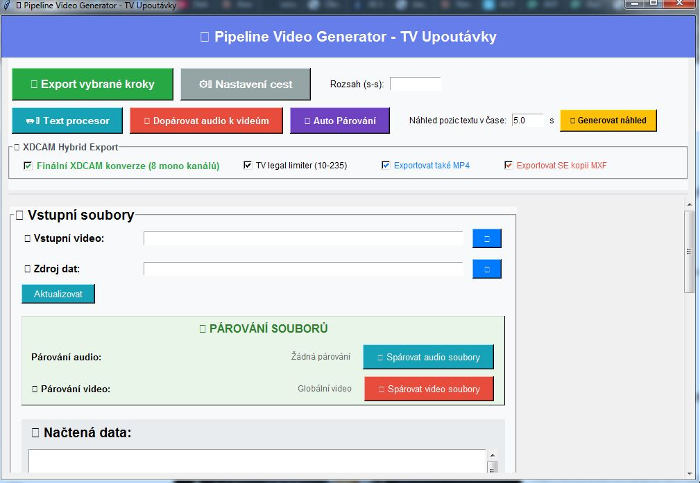
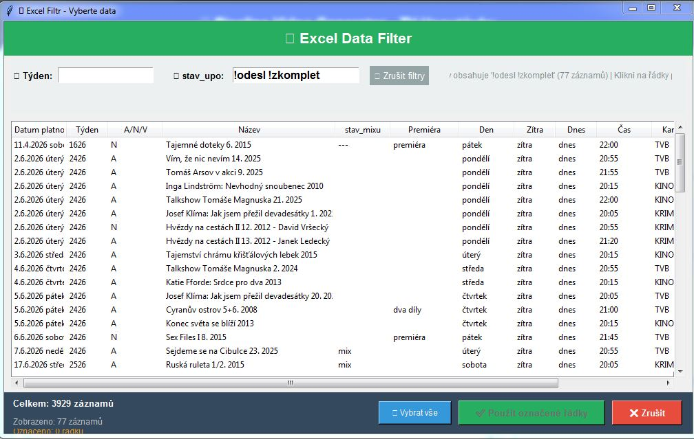
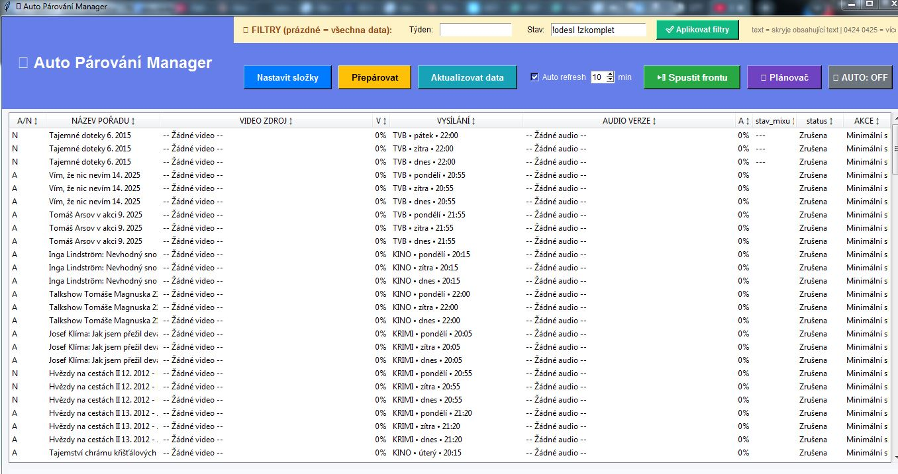
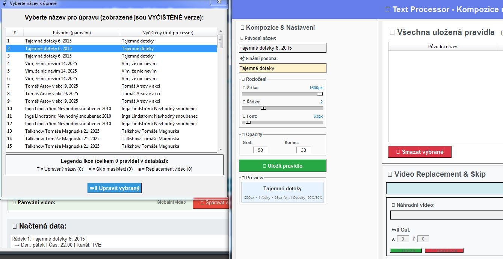

# Pipeline Video Generator – TV upoutávky

> Zdrojový kód tohoto nástroje není veřejný. Rád ho ukážu na pohovoru.

Desktopová aplikace, která v ostrém provozu televize automatizovala výrobu upoutávek. Pokrývala práci odpovídající **400+ hodinám měsíčně**.

## Problém

Televize vysílá každý den desítky upoutávek na několika kanálech. Ke každé je potřeba připravit verzi s konkrétním dnem a časem vysílání, připojit správné video a zvuk, doplnit titulky a vyexportovat ji ve vysílacím formátu.

## Jak to funguje

### 1. Data z Excelu
Program načte plán upoutávek z Excelu (tisíce záznamů) a filtruje je podle týdne a stavu. Ke každé upoutávce zná název pořadu, den, čas, kanál, premiéru a stav zpracování.

### 2. Automatické párování
Auto Párování Manager ke každému řádku sám najde odpovídající video a zvukovou verzi podle názvu a ukáže míru shody. Data se umí sama obnovovat v nastaveném intervalu. Hotové upoutávky jdou do exportní fronty, kterou lze spouštět ručně, plánovačem, nebo v automatickém režimu.

### 3. Text procesor
Vyčistí názvy pořadů pro titulky a nastaví jejich rozložení (šířka, počet řádků, velikost písma, průhlednost) s okamžitým náhledem. Úpravy se ukládají jako pravidla, takže se jednou nastaví a příště se použijí samy. Pravidlo může také vynechat koncovou masku nebo text, nebo použít náhradní video s vlastním střihem.

### 4. Export do vysílacího formátu
Vybrané kroky proběhnou hromadně přes FFmpeg:
- finální konverze do XDCAM (MXF, 8 mono zvukových kanálů),
- TV legal limiter (úrovně 10–235),
- volitelně i MP4 a kopie MXF,
- náhled pozic textu v čase před exportem.

Samostatný krok umí dopárovat zvuk k už hotovým videím.

## Technologie

- Python, uživatelské rozhraní v tkinteru
- FFmpeg a ffprobe (přibalené v exe)
- Čtení dat z Excelu
- Modulární stavba z desítek souborů (zpracování videa, párování, text procesor, konfigurace, paměť projektu)
- Sestaveno do exe pro Windows (PyInstaller)

## Výsledek

- Běžel v ostrém provozu televize.
- Pokrýval práci odpovídající 400+ hodinám měsíčně.

## O vzniku

Nástroj jsem navrhl a postavil s pomocí AI (Claude). Zadání, návrh postupu, testování na reálném vysílacím materiálu a ladění v provozu jsou moje, kód jsem generoval a upravoval s AI.
