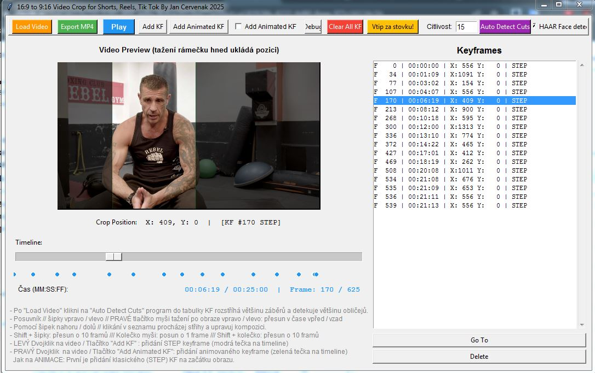

# Reels Cropper

Desktopová aplikace, která z vodorovného videa (16:9) udělá svislé video 9:16 pro Instagram Reels, YouTube Shorts a TikTok.

Vznikl pro převod televizního materiálu na sociální sítě. Ruční ořez ve střihovém programu trvá dlouho, protože se rámeček musí posouvat za lidmi v každém záběru. Reels Cropper většinu té práce udělá automaticky a zbytek se doladí ručně.



## Co umí

- **Automatická detekce střihů:** najde střihy ve videu a ke každému záběru založí keyframe.
- **Detekce obličejů:** v každém záběru vycentruje rámeček na největší obličej. Na výběr je rychlá metoda Haar Cascade, nebo přesnější neuronová síť (DNN, ResNet-SSD). Když DNN obličej nenajde, použije se automaticky Haar.
- **Keyframy:** dva typy keyframů:
  - **STEP** drží pozici až do dalšího keyframu,
  - **ANIMATED** rámeček plynule posune (lineární interpolace), například když člověk v záběru přejde.
- **Ruční úpravy:** tažení rámečku myší, procházení střihů šipkami, krok po jednom nebo po deseti framech, undo a redo.
- **Export přes FFmpeg:** H.264, 1080×1920, 25 fps, AAC 320 kb/s. Pozice rámečku se do FFmpegu předává jako časový výraz, takže se video vykreslí najednou bez mezikroků.
- **Vysílací formáty:** u MXF souborů s 8 zvukovými stopami smíchá zvuk do sterea. MOV a MP4 zpracuje běžně.

## Jak to funguje

| Soubor | Co dělá |
|---|---|
| `reels_cropper.py` | spouštěcí soubor, kontrola knihoven |
| `reels_gui.py` | uživatelské rozhraní (tkinter) |
| `video_player.py` | načítání videa a cache posledních framů |
| `scene_detector.py` | detekce střihů podle rozdílu mezi framy |
| `face_detector.py` | detekce obličejů (OpenCV Haar a DNN) |
| `keyframe_manager.py` | keyframy a interpolace pozice |
| `export_manager.py` | sestavení příkazu pro FFmpeg a export |

## Spuštění

Potřebuješ Python 3.7 nebo novější a [FFmpeg](https://ffmpeg.org/) v systémové cestě, případně ve složce `ffmpeg/bin/` vedle programu.

```
pip install -r requirements.txt
python reels_cropper.py
```

Pro přesnější detekci obličejů stáhni model `deploy.prototxt` a `res10_300x300_ssd_iter_140000.caffemodel` do složky `models/`. Bez nich program použije Haar Cascade.

Hotová verze pro Windows (.exe) je v sekci [Releases](../../releases).

## Postup

1. **Load Video** – načti vodorovné video.
2. **Auto Detect Cuts** – program najde střihy a obličeje.
3. Šipkami nahoru a dolů projdi střihy a případně posuň rámeček.
4. Kde se člověk v záběru hýbe, přidej na konec pohybu **Animated KF**.
5. **Export MP4**.

## O vzniku

Nástroj jsem navrhl a postavil v roce 2025 s pomocí AI (Claude). Zadání, testování na reálném materiálu a ladění jsou moje, kód jsem generoval a upravoval s AI.
