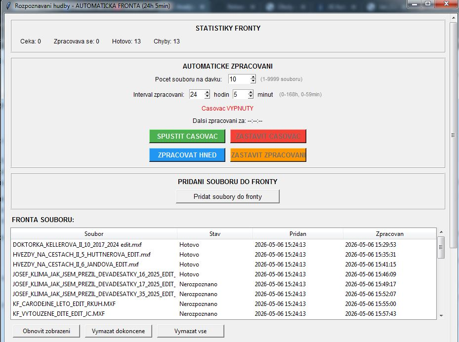

# Rozpoznávání hudby

Aplikace, která ve videích a zvukových souborech najde použitou hudbu a vypíše název skladby, interpreta, vydavatele, rok a délku použití. Hodí se na hudební výkazy (např. pro OSA), kde je potřeba ke každému pořadu nebo upoutávce uvést, jaká hudba v něm zazněla a jak dlouho.



## Co umí

- **Vysílací MXF s 8 zvukovými stopami:** rozdělí je, změří energii každé stopy a dál pracuje jen se stopami, kde něco hraje.
- **Rozpoznávání přes ACRCloud API:** zvuk prochází po krátkých vzorcích (výchozí 7 s, krok 3,5 s) a každý vzorek pošle k rozpoznání.
- **Výpočet délky skladby:** slučuje překrývající se úseky a pozná, když stejná hudba hraje paralelně ve více stopách.
- **Fronta souborů s časovačem:** soubory se zpracovávají po dávkách v nastaveném intervalu (výchozí 3 soubory každých 24 h 5 min), aby se nepřekročil denní limit API. Fronta se ukládá, takže přežije zavření programu.
- **Výstup do TXT:** jeden řádek na soubor, skladby oddělené `|||`.
- **Ovládání v okně (tkinter):** statistiky fronty, odpočet do další dávky, opakované zpracování souboru pravým tlačítkem, log.

## Nastavení

Program potřebuje účet na [ACRCloud](https://www.acrcloud.com/). Zkopíruj `config.example.json` jako `config.json` a vyplň do něj svůj klíč. Soubor `config.json` se na GitHub nenahrává.

## Spuštění

Potřebuješ Python 3.7 nebo novější a [FFmpeg](https://ffmpeg.org/) v systémové cestě.

```
pip install -r requirements.txt
python rozpoznavani_hudby.py
```

## O vzniku

Vytvořeno s pomocí AI (Claude). Zadání, testování na reálném materiálu a ladění jsou moje.
